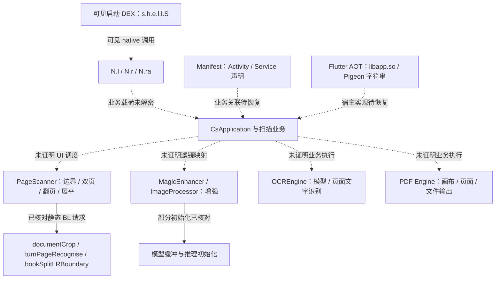

# CamScanner（扫描全能王）Android 本地功能分析

分析日期：2026-11-22。样本：`/Users/bytedance/Downloads/CamScanner.apk`。本文供 KingOfScan 的功能规划和实现对照使用。

## 1. 分析范围与主要结论

这个 APK 同时包含设备端扫描/图像处理组件、本机文档和 PDF 工具、云端 OCR/增强/转换，以及账号与会员机制。应分别判断“设备内是否有处理能力”“产品是否提供入口”“当前用户是否能使用”“整个流程是否离线”。这四个问题不能互相替代。

本次主要补充和修正如下：

- APK 的资源明确区分“本地提取”和“云端精准识别”，不能把所有 OCR 排除为联网功能；本地设置列出自动项和 19 种语言，但实际模型、首次安装时的离线识别仍未验证。
- 本机 PDF 生成/导出有独立设置和原生能力线索，不能与转 Word、转 Excel 等在线转换一并排除。
- `cs_684_filter_*` 资源族列出 11 项滤镜。高级处理另有联网、会员和日额度提示，不能把整组滤镜认作已验证的离线能力。
- 扫描设置 XML 可确认若干初始值，例如自动裁剪开启、高画质扫描关闭；普通自动快门的默认值和触发阈值仍未知。
- 加固使业务 DEX 没有直接暴露。本次确认的实际 DEX 类定义只有 4 个壳类，不把旧 JADX 返回的 6 项当作应用业务类规模。
- 已在全新、无活动默认网络的 ARM64 模拟器尝试启动。安装成功，但进程在首页出现前以信号 9 退出，因此没有获得实际扫描、滤镜、会员或 OCR 的运行结果。

全文采用以下证据等级：

| 标记 | 含义 | 可以证明什么 |
|---|---|---|
| **静态事实** | APK 清单、XML 属性、DEX 指令、ELF 符号/依赖和资源原文直接可见 | 对应内容随本样本存在 |
| **产品宣称** | 帮助文案、权益介绍、错误提示、配置中的功能描述 | 产品为该流程准备了相应说明；不等于本次实际执行 |
| **推断** | 多种独立证据支持的可能处理关系 | 可作为实现方向，不能当已还原业务调用链 |
| **运行观察** | 本次测试环境中实际发生的行为 | 仅适用于所记录环境与操作 |
| **未知** | 缺少业务代码、模型解析或实际操作证据 | 保留为待验证，不能以通用实现或功能名称填补 |

“本地候选能力”指本机处理接口或相应产品模式存在。它不承诺免登录、免会员、免模型下载，也不承诺每次处理都不请求服务器。资源中还包含多个代际、地区或实验方案，不把它们拼接成一个已经生效的配置。

## 2. 样本身份与完整性

| 项目 | 本次结果 |
|---|---|
| 应用名称 | 默认 `CamScanner`；中文 `扫描全能王` |
| 包名 | `com.intsig.camscanner` |
| 版本 | `7.27.0.2609230000`，versionCode `72701` |
| SHA-256 | `9f7267572ebc56d109d07cc64498f608ac080a7b2f759f3be870729c546eb5e7` |
| APK 大小 | 171,567,698 字节，约 163.62 MiB |
| ZIP 条目 | 13,115 项，均为普通文件，无重复路径 |
| 解压后条目大小合计 | 248,898,540 字节，约 237.37 MiB |
| Android SDK | min 21；target/compile 36 |
| 原生 ABI | `lib/` 下只有 `arm64-v8a`，共 68 个 `.so` |
| 原生库大小合计 | 约 123.40 MiB |
| 资源 | 35,128 个唯一 ID；8,881 个 string、2,829 个 layout、35 个 XML、44 个 raw |
| Manifest 组件 | 405 个 Activity、23 个 Activity alias、41 个 Service、29 个 Receiver、32 个 Provider |
| 权限 | 49 次 uses-permission 声明，去重 48 项；`INTERNET` 重复声明 |
| ZIP CRC | 全部条目检查通过 |
| 签名 | `apksigner` 验证 v1、v2 通过；一个签名者 |
| 签名证书 SHA-256 | `7fb4c4f789b7258fc63d300a8e94f393a6a8ec2f29d86dd0cafd1f36347ea23f` |

这些组件计数包括第三方 SDK，不能理解为 405 个用户功能。签名验证说明本样本相应签名校验通过，不单独证明其下载来源或它是最新发行包。版本字符串中的日期式片段也不作为独立发布日证据。

旧文档的 13,116 条目修正为本次直接读取 ZIP 中央目录得到的 13,115 项。哈希与旧文档一致；不推测旧工具计数差异的来源。

## 3. 加固与实现结构

### 3.1 为什么业务调用链没有直接还原

唯一的 `classes.dex` 大小为 13,908 字节，格式 DEX 035。其 `class_defs_size=4`，定义 `s.h.e.l.l.A`、`C`、`N`、`S`；106 个 method ID 包含被引用方法，不等于 106 个业务方法。

Manifest 的 `application.name=s.h.e.l.l.S`，`appComponentFactory=s.h.e.l.l.A`。可见 DEX 指令显示：

1. `S.attachBaseContext` 调用 `N.l(Application, "com.intsig.camscanner")`，再调用 `N.r(Application, "com.intsig.camscanner.launch.CsApplication")`。
2. `S.onCreate` 调用 `N.ra(...)`，并在 `S.n` 非空时调用被代理 Application 的 `onCreate`。
3. `N.l/r/ra/al` 等是 native 方法；可见 Java 层没有它们的处理体。`al` 的声明涉及 `ClassLoader`。
4. 加载器包含 `assets/ijm_lib/%s/libexec.so`、`libexecmain.so` 路径，并调用 `System.load`/`loadLibrary`。

包内还包含 `assets/ijiami.dat`（22,614,265 字节）、`assets/ijiami.ajm`（14,113,823 字节）和加固相关库。这些支持“样本包含启动壳和受保护载荷”的判断；本次未解密载荷，未恢复扫描 Activity、滤镜调度、权限判断或网络回退的完整业务实现。

旧 JADX 清单还列出 `R` 与 `kotlin.coroutines.jvm.internal.DebugProbesKt`。本次确认 `DebugProbesKt.bin` 以 `CAFEBABE` 开头，是另一个 JVM 字节码载体。旧工具的顶层对象清单与真实 DEX `class_defs` 口径不同，不能混算，也不能由“只返回 6 项”推断整个 APK 只有 6 个类。

### 3.2 可确认的模块边界

Manifest 声明 Android Activity 和独立处理进程；APK 还同时包含 `libapp.so`（39,388,064 字节）、`libflutter.so`（10,814,048 字节）、Flutter Activity 和资源清单。可以确认 Android、Flutter AOT 和原生处理组件共存；尚未恢复它们完整的界面职责和调用分工。



实线仅表示本次有指令证据的静态调用请求，虚线表示尚未恢复的业务关联。静态调用存在也不等于已观察运行时执行；ELF 的 PLT 请求需与实现地址分开记录。

本次选取 23 个原生库深入检查，恢复 23,793 条动态符号记录和 327 条 `Java_`/`JNI_` 名称记录。后者包含 `JNI_OnLoad`，不是 327 项用户功能。89 个选定函数条目中，41 个声明范围可连续解码，48 个不能；可解析的直接 BL/B 共 1,044 条。没有跳过坏字节后继续猜测函数体。

尤其需要纠正节表统计：`libOCREngine.so`、`libpdfengine.so` 的 `.dynsym` 都只列 3 项，但从 `PT_DYNAMIC → DT_SYMTAB/DT_STRTAB/DT_HASH` 重建后分别得到 1,619、1,148 项。OCR/PDF 的真实 JNI 和实现符号因此可见。相应函数体仍不能直接连续解码，不能把恢复符号表写成已恢复执行逻辑。

### 3.3 本地功能总览

| 功能 | 产品入口/配置证据 | 原生能力证据 | 本次结论与边界 |
|---|---|---|---|
| 相机拍摄、图片导入 | 相机模式、导入深链、SEND alias | YUV/Bitmap/文件输入接口 | 输入模式随包存在；未获得真实拍摄结果 |
| 实时边界与手动裁边 | 自动裁剪设置、拖动手柄帮助 | `DetectBorderYUV`、`documentCrop`、帧状态 | 有实际静态调用及稳定性条件；最终 UI 样式未知 |
| 透视裁切与页面展平 | 裁边帮助、书籍模式 | 裁剪/展平、曲线和样条接口 | 本地处理候选；精确几何模型与输出未验证 |
| 双页书籍、翻页自动拍 | AB 区域、阅读方向、翻页提示 | 拆分 JNI 调用、翻页数值状态 | 拆分与状态实现有证据；不能据此还原快门完整条件 |
| 长图拼版 | 拼图、长图资源 | `LongImageStitch` 缩放/按坐标复制 | 确认简单画布累加实现，未证明它自动匹配重叠 |
| 连续大幅面扫描 | 连续移动/自动拼接文案 | 关键帧、配准、SIFT/APAP 相关符号 | 与简单拼版分开；业务选择和算法组合未知 |
| 传统滤镜 | 增亮、增强锐化、黑白等名称 | ScannerEngine 增强/颜色处理接口 | 随包有处理表面；逐项参数和全流程离线仍未验证 |
| 高级增强 | 智能高清、去阴影、去手写、去水印 | 去阴影、去模糊、手指/摩尔纹等接口 | 不能将不同组件拼成全部滤镜的本地闭环 |
| 本地 OCR | 本地提取、本地语言 XML | 页面识别、模型生命周期、语言分派 | 存在本地模式与引擎；可用模型和首次离线推理未知 |
| 本机 PDF | 导出到手机、PDF 设置 | 画布/图像/文本/密码/写文件符号 | 强支持本机生成能力；未得到导出文件或内部调用链 |
| 文档批量编辑 | 合并、提取、排序、旋转等菜单 | 不据菜单归因到单一库 | 操作声明明确；数据清除和回滚实现未知 |
| 签名、水印、私密/加密 | 独立工具及权益说明 | PDF 密码等符号，私密说明另列 | 功能类别明确；门槛、密钥和实际保护范围须分开验证 |

同步、云备份、云端精准 OCR、在线分享、Office 转换、翻译和 AI 对话等仅用于说明边界，不计入本次已验证的本地处理功能。

### 3.4 推理组件与其他分类能力

`PageScanner` 的真实静态依赖包含 `libopencv.so`、`libMNN.so`；OCR 使用 `libCVNN.so`。多个推理运行时同时随包存在，不能推定所有高级功能共用同一模型或同一 backend。

| 库 | 可确认表面 | 边界 |
|---|---|---|
| `libMNN.so` | `_ZN3MNN11Interpreter16createFromBufferEPKvm`（`0x31608`）、`_ZN3MNN11Interpreter13createSessionERKNS_14ScheduleConfigE`（`0x32aa8`） | 缓冲模型与推理会话；未确定全部模型的线程/backend 配置 |
| `libCVNN.so` | 缓冲/文件模型、创建/运行/释放会话；OCR 有相应导入 | 不能据库名认定具体网络结构或 GPU 使用情况 |
| `libncnn.so` | `_ZN5ccinn3Net10load_paramEPKh`（`0x59d64`）、`_ZN5ccinn3Net10load_modelEPKh`（`0x5a2f0`） | 原始命名空间是 `ccinn`；不改写为不存在的 `ncnn::` 符号 |
| `liboctopus_classifier.so` | 摩尔纹、清晰度、场景、多模态、分类等接口 | 分类输出不等于图像复原；模型路径字符串不证明模型已加载 |
| `libTAGEngine.so` / `libTAGEngineV2.so` | 页面分类、与 OCR 结果协同、标题/结果接口 | 不据 `GetVLMTitle` 名称认定完整本地 VLM 或云执行路径 |
| `libQREngine.so` | 二维码初始化、解码、编码与文件接口 | 与文档页面 OCR 分开 |

## 4. 产品入口、模式与扫描设置

### 4.1 首页配置和相机模式

`assets/main_page_scan_func_distribute_data.json` 的 `/data/cs_diamond_position/0/content` 有八项：

| `mode` | 配置中的功能说明 | 深链 `type` |
|---|---|---|
| `normal` | 智能扫描 | 713 |
| `import_image` | 导入图片 | 309 |
| `import_file` | 导入文档 | 201 |
| `pdf_utils` | PDF 工具包 | 2 |
| `certificate` | 扫描证件 | 301 |
| `topic_paper` | 试卷去手写 | 310 |
| `doc_to_word` | 拍图转 Word | 615 |
| `all_function` | 全部功能 | 8 |

`_gp.json`、`_id.json` 的部分位置分别替换为证件照、电子签名或扫码。它们说明打包了多套候选配置，具体选择条件未知。

`assets/local_scene_recommend_data.json` 的场景对象还声明相机深链：文档 `mode=1`、证件 `5`、试卷 `8`、证件照 `13`、书籍 `18`。工具箱配置另有照片高清修复 `19`、白板 `27`、公式 `31`、水印相机 `36`。这些 `mode` 与工具箱 `type` 是不同参数，不能当成同一枚举。

深链配置是静态入口证据，本次未访问这些 URL，也没有验证点击路由和模式可用性。

### 4.2 扫描设置的 XML 初始值

`xml/settings_image_scan`（`0x7f16001a`）实际文件为 `res/e-q.xml`。

| 设置 | preference key 的值 | XML 初始值 |
|---|---|---|
| 高画质扫描 | `KEY_ENABLE_TEN_MILLION` | false |
| 自动裁剪图片 | `setting_auto_trim` | true |
| 每拍一张裁剪一次 | `KEY_MULTI_CAPTURE_ADJUST_TRIM` | false |
| 图像增强处理模式 | `KEY_ENHANCE_MODE_INDEX_V1` | 未声明 |
| 启动就拍照 | `KEY_START_DO_CAMERA` | false |
| 使用系统相机拍摄 | `KEY_USE_SYS_CAMERA` | false |
| 使用系统相册导入 | `KEY_USE_SYS_GALLERY` | false |
| 扫描后自动保存扫描件到相册 | `KEY_SAVE_TO_GALLERY` | false |
| 二次聚焦 | `KEY_DOUBLE_FOCUS` | false |

其中高画质使用 `SwitchCompatVipPreference`，只能确认会员型控件声明，不能单凭类名判定拦截方式。文案说明系统相机开启后仅能单拍；系统相册选项在单拍模式生效；二次聚焦可能减慢拍照速度。

单拍、多拍、默认工作台各有独立滤镜 key：`KEY_6_28_0_SINGLEMODE_FILTER`、`KEY_6_28_0_MULTIMODE_FILTER`、`KEY_6_52_0_WORKBENCH_FILTER`，XML 未声明具体初始滤镜编号。不能写成“默认使用智能高清”。普通“自动拍照”虽有资源标签，也未从本设置 XML 得到开关默认值。

这里确认的是打包默认配置。首次运行初始化、历史设置、渠道配置和账号状态是否覆盖这些值尚未知。

### 4.3 资源支持的操作顺序

帮助文案描述：进入相机后可从顶部“更多”关闭自动裁剪；导入多图时可从底部工具栏选择滤镜和自动裁剪；裁边页可拖动手柄；选中图片后可统一旋转、裁剪或换滤镜。对应资源包括 `cs_521_process_layer_tip2/3`、`cs_527_guide_crop`、`cs_521_ocr_layer_tip5`。

因此可把“采集/导入 → 页面范围调整 → 图像处理 → 页面/文档保存”作为产品流程模型。尚未还原其参数、回调、异步任务、缓存和写盘先后，不把这条模型画成已经跟踪的实际调用链。

## 5. 页面识别、裁切与书籍扫描

### 5.1 输入、边界与裁切接口

`lib/arm64-v8a/libpagescanner.so` 有 104 条 `Java_com_intsig_nativelib_PageScanner_*` 定义。下表用 **统一前缀 `Java_com_intsig_nativelib_PageScanner_` 加后缀** 表示完整 JNI 原始符号；地址均为 ELF 链接虚拟地址，不是运行时 ASLR 地址。

| 后缀 | 地址 | 静态证据说明 |
|---|---|---|
| `initDetectBorder` | `0x75598` | 检测初始化 |
| `DetectBorder` | `0x7578c` | 图像边界入口 |
| `DetectBorderYUV` | `0x75cd8` | YUV 边界入口；BL 请求 `documentCrop` |
| `InitDetectFrameBorder` | `0x75b6c` | BL 请求状态重置 `ResetVedioCrop` |
| `DetectFrameBorder` | `0x75b88` | BL 请求 `documentCrop` |
| `initPageSplit` | `0x74ebc` | 页面拆分初始化 |
| `ScanImgP` / `ScanImgPNew` | `0x750b0` / `0x75210` | 分别 BL 请求双页边界拆分实现 |
| `initCropDewarp` | `0x79ae8` | 裁切/展平初始化 |
| `DewarpImgFileNew2` | `0x7dd48` | 图像文件展平入口 |
| `CurveCropDewarpImagePosFile2` | `0x7fbe4` | 曲线/位置约束的裁切展平入口 |
| `DetectCurveBorderYUV` | `0x88aa8` | YUV 曲线边界入口 |
| `SplineFitAdjustCurves` | `0x8921c` | 样条拟合调整入口 |
| `detectBorderModeIoU` | `0x89464` | IoU 相关模式入口 |

还可见 `findCandidateLines`、`findCandidateCurves` 等符号。接口族支持矩形、曲线、候选线和多帧处理能力，但不能仅据名称断言它以 Canny/Hough 或某种神经网络完成边界检测。

直接调用进一步明确了证据强度：`DetectBorderYUV` 在 `0x75d80`、`DetectFrameBorder` 在 `0x75c2c` 经 PLT `0x6c350` 请求 `documentCrop`（同库定义 `0xa8528`）；`documentCrop` 在 `0xa8878` 请求下述多帧状态函数。这比只有导出名更强，但仍未跨越到隐藏的相机业务调用层。

参数检查字符串包括 `DetectBorder regions length < 8`、`currentBorder must has 8 elements`、`Lines must has 400 elements`。它们是接口契约线索，不能推断最终角点坐标是屏幕像素还是原图坐标，也不能把 400 项解释成 400 条边线。

### 5.2 多帧边界一致性：已恢复的条件

`_ZN8pagescan13SinglePageSet15addCurrentFrameERNS_5mRectE`，地址 `0xa7e6c`、声明大小 444 字节，可连续解码：

| 路径 | 指令支持的行为 | 返回值 |
|---|---|---|
| 累计数未到窗口 `N` | 存储当前 8 个整数记录 | `3` |
| 窗口已满 | 删除旧记录、加入当前记录，逐项比较历史与当前记录 | 继续判断 |
| 一条历史记录匹配 | 8 项整数差的绝对值都 `<=150` | 计入匹配数 |
| 匹配数达到整数比较界线 `2*N/3` | 当前窗口达到该一致性条件 | `1` |
| 未达到界线 | 当前窗口不满足该条件 | `2` |

前 7 项使用 `cmp #0x96` 后排除较大值；最后一项通过 `<151` 判断，等价于 `<=150`。`ResetVedioCrop`（`0xa8f84`）清空历史，将调用者传入整数存为窗口配置。

因此可以确认存在带历史窗口的边界一致性状态判断。`N` 没有恢复为固定默认帧数；`150` 的单位未确认；`1/2/3` 没有恢复为快门业务枚举。不能据这些数值写成“抖动小于 150 屏幕像素便自动拍摄”或固定多少毫秒触发。

### 5.3 双页、翻页与曲线展平

`ScanImgP` 在 `0x75138` 请求 `bookSplitLRBoundary`（`0xcb47c`）；`ScanImgPNew` 在 `0x75298` 请求 `bookSplitLRBoundary_new`（`0xce390`）。双页拆分因此有实际静态调用证据。`dewarp_process_new`（`0xbc9c8`）和 `bookfingerFill`（`0xc5b28`）另有定义，且错误文案明确书页展平失败时跳过手指填补；尚未恢复这两步完整的输入输出与业务连接。

翻页接口 `InitBookTurnPage`（`0x80800`）、`InitDetectFrameTurnPage`（`0x80b64`）、`DetectTurnPage`（`0x809f4`）随包存在。`DetectTurnPage` 在 `0x80a98` 请求 `turnPageRecognise`（`0xd580c`）；后者请求 `turnpage::BlurValue`（原始符号 `_ZN8turnpage9BlurValueERKN2cv3MatE`，`0xd451c`）及帧状态函数。

`_ZN8turnpage11TurnPageSet15addCurrentFrameEiiPid`（`0xd39f4`）可连续解码，观察到：

1. 四坐标整数和为 `-4` 的路径不追加，返回 `2`；未满窗口则追加两个整数、四坐标和一个 double，返回 `2`。不能把和为 `-4` 严格等同于四个坐标全部 `-1`。
2. 一个状态标志未置位时，某整数的窗口和达到 `3`，便置位并返回 `2`；否则返回 `3`。
3. 标志已置位时，第一项当前整数须为 `1`，对应窗口和须达到 `9`，才继续计算两个稳定性指标。
4. double 与历史值的平均绝对差、四坐标记录的平均绝对差分别小于 `2.0`、`10.0` 时，返回 `1` 并清除标志；否则返回 `2`。
5. `ResetVedioTurnPage`（`0xd78fc`）清空四组历史、累计数归零、标志设为 `1`，并保存调用者的窗口配置。

double 指标与模糊度稳定性有关是由调用关系支持的推断，未恢复原始字段名。数值 `3/9/2.0/10.0` 属于已读到的原生状态条件；窗口大小、坐标尺度、相机帧率、UI 快门映射和外围条件仍未知。

### 5.4 书籍产品流程与视觉边界

资源对书籍操作的描述较此前更明确：

- `cs_611_camera_16`（`0x7f120bcd`）：“请横置手机”。
- `cs_611_camera_17`（`0x7f120bce`）：“书籍的左右两页对应AB区域”。
- `cs_611_camera_15`（`0x7f120bcc`）：“点击翻转，适合从右向左阅读的书籍”。
- `cs_690_turn_page_02`（`0x7f1218a3`）：“点击拍摄按钮，跨页扫描书籍”。
- `cs_690_turn_page_03`（`0x7f1218a4`）：“自动拍摄中，请匀速翻页”。
- `cs_690_turn_page_05`（`0x7f1218a6`）：“普通用户每日上限 %s 次，升级会员不限次数，解锁全部功能”。

这些文案支持横置双页、阅读方向切换、翻页自动拍等产品设计。`%s` 未解析，不能填入次数，也不能判断一次是会话、翻页还是拍摄页。书籍快门布局 `pnl_book_capture_shutter_refactor`（`0x7f0c090e`，`res/J3x.xml`）包含拍摄/停止相关视图，其中部分初始隐藏，不能还原运行截图。

实时边界线的最终颜色、宽度、角点、蒙层、出现/消失动画、检测频率、置信度阈值、丢失后的保持策略，以及翻页稳定多久触发快门均未验证。宣传动效、`ps_detected.png` 或旧 iPhone 教程都不能代替真实相机画面。

## 6. 滤镜与图像增强

### 6.1 完整的 11 项名称资源族

以下来自 `resources.arsc` 中 `cs_684_filter_*` 的 `(zh)` 值。它是该资源族的完整清单，不能直接当作运行时菜单顺序或全离线清单。

| 资源 ID | 名称 | 中文原文 |
|---|---|---|
| `0x7f1217c2` | `cs_684_filter_original` | 原图 |
| `0x7f1217bd` | `cs_684_filter_lighten` | 增亮 |
| `0x7f1217ba` | `cs_684_filter_enhance` | 增强锐化 |
| `0x7f1217b8` | `cs_684_filter_bw` | 黑白 |
| `0x7f1217b9` | `cs_684_filter_eco` | 省墨 |
| `0x7f1217bb` | `cs_684_filter_grayscale` | 灰度 |
| `0x7f1217bc` | `cs_684_filter_invert` | 反色 |
| `0x7f1217bf` | `cs_684_filter_noshadow` | 去阴影 |
| `0x7f1217be` | `cs_684_filter_nohandwriting` | 去手写 |
| `0x7f1217c0` | `cs_684_filter_nowatermask` | 去水印 |
| `0x7f1217c1` | `cs_684_filter_omnifix` | 智能高清 |

传统增强与高级模型不能仅按名称一一映射。`libscannercs.so` 有 `ScannerEngine_enhanceFile/enhanceBitmap/enhanceImageS`，`libimageprocessor.so` 有颜色映射、去模糊和擦除细化接口；本次未恢复滤镜编号到这些接口的业务分发表。

| 名称/处理类别 | 原生证据 | 可确认范围 |
|---|---|---|
| 原图、增亮、增强锐化、黑白、省墨、灰度、反色 | 传统增强、二值/颜色变换接口存在 | 有传统处理组件；不能确定每项参数、运算顺序或与 KingOfScan 同算法 |
| 去阴影 | `MagicEnhancer_initDeshadowModelNew`、`deshadowFileNew`，以及 `scanet` 模型/处理符号 | 有去阴影初始化和处理入口；阴影分类与阴影移除分开 |
| 智能高清 | `ImageSilverBulletFile`、去模糊/增强等组件；另有多步骤产品文案 | 复合增强候选；无法确定完整步骤及本地/云选择 |
| 去手写 | 手写分类模型生命周期、擦除细化接口分别存在 | 未证明两者形成去手写闭环，不能认定手写像素移除已还原 |
| 去水印 | 该名称资源及擦除相关入口 | 未将内容水印识别/移除关联到完整本地实现 |
| 去手指 | 手指检测 JNI、另有 `scanet::remove_finger` 与书页填补函数 | 检测、移除、书页填补是不同证据；UI 调度未知 |
| 摩尔纹 | 分类、mask 提取、内嵌模型初始化路径 | 已确认模型缓冲与 mask 提取调用；未恢复完整图像复原 |
| 杂物/杂斑 | `initZawuDetect`、`zawuDetectPath`、`zawu_detect.mnn` 字符串 | 有检测候选，不能扩展成任意物体消除 |

下表的完整 JNI 名称使用各行声明的前缀加后缀：

| 库/前缀 | 后缀 | 链接地址 |
|---|---|---|
| `libmagicenhancer.so` / `Java_com_intsig_nativelib_MagicEnhancer_` | `initDeshadowModelNew` / `deshadowFileNew` | `0x120d8` / `0x13090` |
| 同上 | `classifyShadowTypeBitmap` | `0x15bf4` |
| 同上 | `initMoireMaskExtract` / `MoireMaskExtractFile` | `0x13600` / `0x13688` |
| 同上 | `initFingerDetect` / `fingerDetectBitmap` | `0x16540` / `0x165c8` |
| 同上 | `ImageSilverBulletFile` | `0x19e50` |
| 同上 | `initZawuDetect` / `zawuDetectPath` | `0x1a750` / `0x1b6dc` |
| `libimageprocessor.so` / `Java_com_intsig_nativelib_ImageProcessor_` | `initDeblur` / `deblurFile` / `deblurPtr` | `0xb8e4` / `0xc3b8` / `0xca28` |
| 同上 | `refineEraseAny` | `0xcd44` |
| 同上 | `ReflectBinaryColorShiftBitmap` / `ReflectBinaryColorShiftBitmapBG` | `0xee6c` / `0x11030` |
| `libscannercs.so` / `Java_com_intsig_scanner_ScannerEngine_` | `enhanceFile` / `enhanceBitmap` / `enhanceImageS` | `0x25090` / `0x26174` / `0x28684` |

其中，去阴影初始化在 `0x120e8` 请求 `_ZN6scanet10init_modelEi`（定义 `0x1da74`）；去模糊初始化在 `0xb8f0` 请求 `_ZN12ImageEnhance10init_modelEv`（定义 `0x36478`）。这些是已核对的静态 BL 请求，仍未证明处理滤镜实际执行。

摩尔纹有更具体的模型证据：`_ZN6scanet16init_moire_modelEi`（`0x2b694`）构造库内缓冲地址 `0x3a3f00`、长度 `0x4ac74`，即 306,292 字节，交给 `_ZN6scanet8InferNet9initilizeEPKvmiibii`（`0x2d030`）。后者在 `0x2d078` 请求 `MNN::Interpreter::createFromBuffer`，在 `0x2d194` 请求 `createSession`。因此至少一个路径使用 `.so` 内嵌模型缓冲，证据强于仅发现 `.mnn` 文件名。

`MoireMaskExtractFile` 在 `0x13900` 请求 `_ZN6scanet13moire_extractERKN2cv3MatERS1_i`（定义 `0x2b8ac`）。这是 mask 提取关联，不等于已经得到去摩尔纹成图。配置整数、模型内部结构、实际业务选择和 mask 后续如何参与复原仍未知。

手写证据应单独保留：`liboctopus_classifier.so` 定义 `_ZN10classifier24__init_handwriting_modelEPKvmi`（`0x85aa0`）、`_ZN10classifier25release_handwriting_modelEi`（`0x86548`），含 `handwriting.mnn` 字符串。分类模型不能单独证明擦除；`refineEraseAny` 也不能未经输入契约确认就认定为“去手写”。

### 6.2 网络与会员边界

必须保留以下原文：

| 资源 | 原文 | 能得出的结论 |
|---|---|---|
| `cs_720_server_super_filter_03`，`0x7f121b6d` | 使用该滤镜需要连接网络，请检查网络后继续处理图片 | APK 存在需要网络的滤镜分支提示；具体对应项未知 |
| `cs_652_superfilter_03`，`0x7f121299` | 文案包含“开启云同步，即刻体验” | 部分高级处理被设计成与云同步关联，不能一概认定本地 |
| `cs_651_filter_vippop`，`0x7f121275` | %s是会员专属滤镜，请升级会员，或更换滤镜。 | 存在会员专属滤镜提示，但 `%s` 不能绑定到未确认名称 |
| `cs_628_filter_limt`，`0x7f120da4` | 该滤镜今日已达到使用上限，请明天再来 | 存在日额度分支提示；数量及对应滤镜未知 |

另外 `cs_642_clarity_content`（`0x7f1210b6`）说明某项 AI 清晰度提升需上传云端授权，并暂不支持人像与风景图。相机最大分辨率、传统增亮/锐化、智能高清滤镜、分享时高清/超清是不同能力，不能按“高清”两个字合并判断。

是否同一个增强入口有本地和服务器两条路径、何时切换、会员权益是否先阻断处理、是否需下载模型，尚未由业务代码或实际滤镜操作确认。

## 7. 多页、长图、编辑与批量处理

### 7.1 长图累加与智能配准

`liblongImageStitch.so` 定义前缀 `Java_com_intsig_nativelib_LongImageStitch_` 的 `Create`（`0xaec`）、`AddImage`（`0xc58`）、`AddBitmap`（`0xdc8`）、`Save`（`0x15e0`）。`AddImage` 的 368 字节可连续解码：

- 输入缩放比例与 `1.0` 不等时，在 `0xcbc` 请求 `MsScaleImage`。
- 根据目的画布、源图及两个调用者整数参数计算起点和可复制宽高，裁到目的边界。
- `0xd40–0xd64` 逐行复制，`0xd4c` 请求 `memcpy`。
- `Save` 在 `0x1628` 请求 `MsEncodeFile`，随后在 `0x164c` 请求 `MsFreeImage`；不能保证所有保存失败分支的行为相同。

这说明该入口是缩放后按坐标放置图像的画布累加，当前解码没有显示它自动搜索图像重叠。`AddBitmap` 的文案要求 `RGBA_8888`，也不能推广为所有导入只能 RGBA。库直接声明依赖 `libmainstone.so`，但本次没有完成所有 `Ms*` 的跨库实现绑定。

另一组能力位于 `libpagescanner.so`，前缀仍为 `Java_com_intsig_nativelib_PageScanner_`：

| 后缀/原始符号 | 地址 | 说明 |
|---|---|---|
| `CreateImageStitchStateV2` | `0x81870` | 多图拼接状态 |
| `initKeyFrameExtractorStateV2` | `0x81980` | 关键帧状态初始化 |
| `extractclearKeyFrameV2` | `0x81a94` | 清晰关键帧提取入口 |
| `StitchMultiImagesFileV2` | `0x820a8` | 多图文件拼接入口 |
| `CreateCancelSessionV2` / `CancelStitchSessionV2` / `ReleaseStitchSessionV2` | `0x82054` / `0x8208c` / `0x82098` | 取消/释放会话 |
| `vl_sift_keypoint_init`（无 JNI 前缀） | `0x144214` | SIFT 相关实现符号 |
| `_Z18ApapStitchInThreadPv`（无 JNI 前缀） | `0x1294e8` | APAP 相关线程函数 |
| `_Z22ImagePairMatchInThreadPv`（无 JNI 前缀） | `0xfa7a0` | 图像对匹配函数 |

关键帧/匹配/SIFT/APAP 表面说明这组能力不能用简单行复制概括。尚未还原主拼接函数到这些步骤的完整调用，也没有确认某一相机入口选择哪组能力、图数/超时/重叠阈值或拼接失败恢复。

### 7.2 多页文档与批量编辑

工具箱配置声明文档合并 `type=204`、提取 `205`、排序 `206`、瘦身 `210`；另有加密 `207`、电子签名 `202`、水印 `203`、AI 擦除 `610` 和消除印记 `709`。连续超大幅面扫描的自动对齐拼接、多页图片拼版和 PDF 页管理是不同任务，不应因为都叫“拼接”而认为共享一种算法。

`assets/cs_list_more.json` 分开配置 `/data/cs_more` 和 `/data/cs_pdf_more`。图片文档可配置保存相册、拼图、去手写、错题组卷、复印件、识别公式、发票识别、证件卡包；PDF 另有逐页转图片、邮件发自己。两者都有文字提取、Word/Excel 转换、页面管理、合并、复制/移动和加密。菜单配置并不证明所有动作均离线。

`layout/bottom_batch_reedit_image`（`0x7f0c0107`，`res/Q8o.xml`）包含左转、右转、裁剪、滤镜。重要的数据变化文案包括：

- `cs_518c_batch_process_warning`（`0x7f12068e`）：“此操作可能会清除原有的图片转文字结果、手写批注、水印及签名，是否继续？”
- `cs_523_body_switch_filter`（`0x7f1207b7`）：“继续操作将清除现有编辑记录（涂抹、签名、文字等）。是否确认清除？”
- 合并有“保留原文档”和“不保留原文档”两个选项，资源为 `a_main_merge_keep_old/no_keep_old`。
- `cs_658_pdf_function_02`（`0x7f1213bd`）：“一次合并最多 500 页”。
- `cs_661_doc_lock_tip04_title`（`0x7f1213f9`）：“不支持批量操作加密文档”。

500 页是该项打包文案的宣称，不能推广为所有扫描、导出或转换的上限。批量处理会如何清除、是否事务提交以及取消/中断后的恢复策略尚未知。也未找到可把所有批量操作统一判定为会员专属的证据。

## 8. 外部导入、本机 PDF 与格式转换

### 8.1 Manifest 中的入口及默认状态

| 外部入口 | 实际目标 | 动作/类型 | 需要注意的状态 |
|---|---|---|---|
| `ShareMultiPageActivity` alias | `BatchModeActivity` | `SEND_MULTIPLE`，JPEG/PNG/HEIF/HEIC | `exported=true` |
| `Scan2PDFActivity` alias | `ImportSinglePageActivity` | `SEND`，JPEG/PNG/HEIF/HEIC；`com.intsig.camscanner.ACTION_SCAN` | `exported=true` |
| `Scan2PDFViewActivity` alias | `ImportSinglePageActivity` | `VIEW`，上述图片格式 | **`enabled=false`**，不能认定默认可接收 |
| `AliasImportSingleOcrActivity` | `ImportSingleOcrActivity` | `SEND`/`SEND_MULTIPLE`；JPEG/PNG/JPG，多图还含 HEIF/HEIC | `exported=true` |
| `AliasImportSingleOcrViewActivity` | `ImportSingleOcrActivity` | `VIEW`，JPEG/PNG/JPG | **`enabled=false`** |
| `ShareToPdfAppActivity` | 同名 Activity | `VIEW`，content/file 的 `.pdf`/`.PDF` 或 `application/pdf`；`SEND application/pdf` | `exported=true` |

`ImageScannerActivity` 同时声明 `NEW_PAGE` 和 `SCAN_IMAGE_ONECLOUD`；不能因为共享组件就把云端动作也列为本地流程。过滤器表示声明的可匹配输入，不能证明 URI 权限保留、文件复制、HEIF 解码或 PDF 导入在所有文件上成功。

### 8.2 本机 PDF 生成和输出

`xml/settings_export_document`（`0x7f160018`，`res/IQ7.xml`）中，普通 `CustomViewPreference` 的 title 是“导出PDF到手机”（`a_setting_title_export_pdf`，`0x7f120319`），key 为 `UPDATEPDF`，summary 是“给所有文档生成PDF，导出至 %s”（`0x7f120317`）。同 XML 的“自动上传”使用独立会员型控件。

相关文案还有“生成PDF可能需要一些时间”“PDF文档已生成”，以及 `pdf_create_error_msg`（`0x7f122184`）：“生成PDF文档失败，请检查SD卡是否可用。”这些能确认本机生成/存储的产品语义，不能单凭文案验证完整执行。

`libpdfengine.so` 的真实动态符号同时包含 JNI、C/C++ 画布和 HPDF 文件输出实现。下表 JNI 的统一前缀为 `Java_com_intsig_pdfengine_PDF_1Engine_`，`_1` 是 JNI 对下划线的转义：

| JNI 后缀 | 地址 | 对应能力表面 |
|---|---|---|
| `createCanvas` | `0x573c8` | 创建画布 |
| `newPage__FF` / `newPage__` | `0x58730` / `0x58798` | 新页面/重载入口 |
| `drawImage` | `0x58590` | 绘制图像 |
| `save2PdfFile` | `0x587e4` | 输出 PDF 文件 |
| `releaseCanvas` | `0x58f38` | 释放画布 |
| `loadFont` | `0x57604` | 字体加载 |
| `drawTextAngle` / `drawTextRect` | `0x577c0` / `0x57dec` | 文字绘制 |
| `addLinkRegion` / `addNote` | `0x57d40` / `0x58d04` | 链接区域/注释 |
| `setPassword` / `setPPI` | `0x58e74` / `0x57530` | 密码/分辨率配置 |
| `setTextRenderingMode` | `0x574c4` | 文字渲染配置 |

同库还定义 `PDF_CreateCanvas`（`0x55df8`）、`PDF_DrawImage`（`0x55ea0`）、`PDF_SavePdfFile`（`0x55fa0`）、`_ZN9PDFCanvas11savePdfFileEv`（`0x56a88`），以及 `HPDF_SaveToFile`（`0x35570`）、`HPDF_FileWriter_WriteFunc`（`0x49c8c`）、`HPDF_SetCompressionMode`（`0x37668`）、`HPDF_SetEncryptionMode`（`0x34dc4`）。

这与导出设置相互支持“具有本机 PDF 构建、图像/文字绘制和写盘能力”的判断。`save2PdfFile`、`PDFCanvas::savePdfFile`、`HPDF_SaveToFile` 的当前文件字节均不能连续解码，未证明 JNI 依次调用这些实现，也未证明当前产品可离线生成带 OCR 文字层的可搜索 PDF。文件密码算法、压缩默认值和写盘失败回滚亦未知。

`libpdfium.so`、`libpdfium_jni.so`、`libjbig2enc.so` 的当前可读动态表主要是包装入口。`libpdfium_jni.so` 的 `JNI_OnLoad`（`0x54c0`）可解码，动态查找 `_Z9My_OnLoadP7_JavaVMPv` 等并以 `BLR` 间接转发；本次未恢复间接目标、内部 `FPDF_*` 或 JBIG2 实现。因此不能用库名直接宣称已经证实 PDF 渲染/压缩算法。

`xml/settings_pdf`（`0x7f16001f`，`res/ogo.xml`）有加密、页码、方向、页面尺寸和留白设置。加密及页码声明 `showVipIcon=true`；其余所列项没有声明该属性。会员图标存在不等于已验证执行门槛。页面留白未声明默认值，也没有实测输出纸张和压缩质量。

Flutter AOT `libapp.so` 可见以下桥接字符串，作为原生宿主接口声明线索：

| 文件偏移 | 完整字符串 |
|---|---|
| `0xeb2ca` | `dev.flutter.pigeon.channel.EngineHostApi.imageToPdf` |
| `0x1af292` | `dev.flutter.pigeon.connections.GpyNativeHostApi.imageToPdf` |
| `0x32e717` | `dev.flutter.pigeon.channel.DocHostApi.saveImagesAsDoc` |
| `0x381e15` | `dev.flutter.pigeon.channel.ShareHostApi.shareSystemFiles` |
| `0x2dc0ea` | `dev.flutter.pigeon.channel.ShareHostApi.shareDocuments` |
| `0x1ef094` | `dev.flutter.pigeon.channel.ShareHostApi.getShareLinkList` |

本机文件分享和获取分享链接是不同接口标识。字符串不是恢复的方法体，不证明调用条件、返回值和执行路径。

### 8.3 在线/混合转换边界

转 Word/Excel/PPT、逐页转图片、转长图在工具箱分别使用 `type=101..105`。转换文案含“由于网络等原因转换失败”“后台正在转换，请勿退出 app”“转换结果保存在首页【文档转换结果】文件夹”。其中 `cs_521_b_transfer_fail`（`0x7f12071d`）明确带网络原因。

`libapp.so` 文件偏移 `0x136783` 还有 `convertToWord blocked: offline doc`，支持“离线文档与 Word 转换有分支关系”的判断，不能据字符串认定它在本次实际阻断。

这些证据不能反向证明 PDF 渲染、逐页转图和图片组装 PDF 必然联网，也不能证明某一 Office 转换必然离线。PDF 导入文案另有登录、大小 `%dM`、密码/损坏/非 PDF 等限制；实际限额未解析，不填写具体值。

## 9. OCR、语言与模型

### 9.1 本地与云端模式存在

| 资源 ID/名称 | 原文 |
|---|---|
| `0x7f120512 cs_5100_local_ocr` | 本地提取 |
| `0x7f12000b a_btn_accurate_ocr` | 云端精准识别 |
| `0x7f12036f a_title_local_ocr_fail` | 本地识别未找到文字，是否尝试使用云端精准识别? |
| `0x7f12172e cs_680_local_ocr_tips_renew` | 建议选择云端提取，提取结果更精准；若网络不佳，本地提取也可提供支持。 |

Manifest 声明私有 `LocalOcrService`，进程为 `:ocr_engine`。资源和服务声明相互支持“设计有本地 OCR 模式”，但本次未进入界面得到识别文字，也未观察本地失败后是否经用户确认才切换云端。

从 `libOCREngine.so` 程序头重建出的真实 JNI 前缀为 `Java_com_intsig_nativelib_OCREngine_`：

| 后缀 | 地址 | 能力表面 |
|---|---|---|
| `GetRequirementsInfo` | `0x476c4` | 引擎要求信息 |
| `GetVersion` | `0x47774` | 版本查询 |
| `LoadModel` / `ReleaseModel` | `0x477f0` / `0x47a0c` | 模型生命周期 |
| `RecognizePageImgFile` | `0x47a58` | 图像文件页面识别 |
| `RecognizePage` | `0x47db4` | 页面识别入口 |

内部还有文本检测、CTC 文本行识别相关符号，及 `_ZN9OCREngine18LanguageDispatcherC1ERKNS_6ModelsERKNS_13RuntimeConfigE`（`0xa01f0`）、`_ZN9OCREngine17CheckLanguageTypeERKNSt6__ndk112basic_stringIcNS0_11char_traitsIcEENS0_9allocatorIcEEEEb`（`0xa554c`）。

真实 `DT_NEEDED` 包含 `libopencv.so`、`libCVNN.so` 和系统库；OCR 导入 `CVNN::Interpreter::createFromBuffer/createSession/runSession`。尽管内部类叫 `backend::MnnNetwork`，其静态依赖不是 `libMNN.so`，不能按类名改写依赖关系。

`LoadModel` 和 `RecognizePage` 当前声明范围无法连续解码，`RecognizePageImgFile` 仅最初 4 字节可解码。因此未恢复模型文件路径、完整 JNI 参数、模型缓冲内容、结果字段、语言枚举值或实际文字输出。语言分派存在不能证明 19 个可选语言都随包可用，也不能确认首次安装即可离线识别。

### 9.2 语言列表的正确范围

`xml/settings_ocr_new`（`0x7f16001e`，`res/8rb.xml`）title 为“本地文字识别语言”，有 20 个 checkbox：自动项加以下 19 种语言。`KEY_OCR_LANG_AUTO` 默认 true，其余所列语言默认 false。

英语、中文（简体）、中文（繁体）、日语、韩语、法语、西班牙语、葡萄牙语、德语、意大利语、荷兰语、俄罗斯语、希腊语、土耳其语、瑞典语、芬兰语、丹麦语、挪威语、匈牙利语。

这是可选项清单，不代表已验证全部语言模型、准确率或首次安装时无需下载。另一份 `settings_ocr_full_new`（`0x7f16001d`，`res/Nk6.xml`）有自动项加 41 种语言，不能把该列表全部写成本地支持。Excel 语言设置另列英、简中、繁中、日、韩五项，默认英语，亦不应混算。

`cs_670_ocr_01`（`0x7f1215e5`）建议选择 1–3 种识别语言；OCR 文案有提取所有页、公式和导出 `.docx`/`.txt`。这些能力各自的本地执行范围未知。

### 9.3 模型不能按名称混认

可明确辨认的三个独立 TFLite 文件位于 `assets/mlkit_barcode_models/`：

| 模型 | 字节数 |
|---|---|
| `barcode_ssd_mobilenet_v1_dmp25_quant.tflite` | 390,456 |
| `oned_auto_regressor_mobile.tflite` | 213,880 |
| `oned_feature_extractor_mobile.tflite` | 276,552 |

三个文件均有 `TFL3` 标识，属于条码识别目录，不能作为文档 OCR 语言模型证据。没有从资源文案找到直接证明“首次 OCR 必须下载模型”的提示，但这一负搜索仅覆盖 8,881 个字符串的名称和值；不能排除原生内嵌模型、加固载荷、动态文案或下载流程。

## 10. 会员、额度与三类水印

会员证据应分成：权益说明资源、静态会员控件/图标、真正执行的账号判断。本次得到了前两类，第三类仍未验证。

### 10.1 能定位到的资源规则

`cs_522_web_*` 保存了证件、签名、图片 OCR、拼图、拍书双页/曲面校正/去手指、高清扫描、文件夹、私密存储、文本导出、PDF 密码等权益说明，也包括云空间和自动上传等云功能。它是含历史说明的资源族，不作为当前销售权益表。

较新的资源另有智能高清、AI 擦除、去手写、翻页自动拍、格式转换和瘦身。应逐功能核对，不能因会员宣传图存在就把所有本地工具都标为收费。

| 资源提示 | 当前可以确认的范围 |
|---|---|
| `cs_692_ocr_14/16`（`0x7f1218f4/0x7f1218f6`）：免费 10 次/月、1000 次/月 | 同族属于“高级提取”；不能推广到所有本地 OCR |
| `cs_668_ocr_2_014/015`：额度不足可用点券、消耗 `%s` 点券 | 不能承诺会员 OCR 绝对无限 |
| 翻页自动拍普通用户日上限 `%s` | 有额度提示，具体次数和计数单位未知 |
| `%s是会员专属滤镜` 和滤镜今日上限 | 未确定具体滤镜和执行条件 |
| PDF 加密/页码的会员图标 | 静态图标配置，不是运行门槛验证 |

购买 JSON 有月/季/半年/年、不同试用金额和时长、不同 SKU。部分方案是远程 banner，未内嵌逐项权益。不能从 `_299_*` 文件名推断当前价格，也不把一套自动续费文案视为实际扣款观察。

### 10.2 水印需要分开分析

1. **平台品牌导出水印**：`a_label_pdf_watermark`（`0x7f12015f`）为“由 扫描全能王 扫描创建”；`a_tip_normal_share_has_ink`（`0x7f120340`）为“非高级会员分享内容会带水印”。
2. **文档内容水印**：用户添加的防盗用水印及“去水印”滤镜处理的内容，不等于平台底部品牌水印。
3. **AI 生成标识水印**：文档管理中的 `key_setting_aigc_watermark` 默认 true，title 为“显示 AI 生成水印”（`cs_730_nol10n_erase_03`，`0x7f121d5a`，此项使用默认 locale 值）。

APK 也有“看视频即可获得1次PDF无水印分享”（`0x7f1208ba`）及视频加载失败赠送一次（`0x7f1208bc`）的文案，还有教育账户例外。它们证明例外提示存在，不证明当前账号实际获赠，也不宜写成“去品牌水印只能付费”。

## 11. 本地数据、分享路径与恢复边界

### 11.1 已确认的配置路径

`androidx.core.content.FileProvider` 的 authority 是 `com.intsig.camscanner.fileprovider`，`exported=false`、`grantUriPermissions=true`。其 `xml/file_paths`（`0x7f16000a`）对应 `res/8Kn.xml`：

| 路径类型 | 配置目录 | 可以确认什么 |
|---|---|---|
| `files-path` | `CamScanner/.temp/` | 应用 files 根下的候选分享目录 |
| `external-path` | `CamScanner/.temp/`、`CamScanner/` | 共享外部存储根下的候选目录 |
| `external-files-path` | `CamScanner/.temp/`、`CamScanner/` | 应用外部 files 根下的候选目录 |
| `root-path` | 空字符串 | 配置允许该根参与 provider 映射；不证明所有路径实际被分享 |

另有 SDK 的 `GDTDOWNLOAD`、`Images/tmp`，不能把它们当扫描文档主库。以上只是 provider 可映射的目录，不等于已观察页面落盘位置或数据库。文档管理设置的 `KEY_FILES_DIR_STORAGE_ROOT` 未声明具体文件系统默认路径；`KEY_PDF_IMPORT_DIR="/"` 是应用归档目录默认值，也不是 Android 根目录。

`DocumentProvider` 的 authority 为 `com.intsig.provider.Documents`，私有且受签名读写权限约束。`OpenApiProvider` 的 authority 为 `com.intsig.provider.CSOpenApi`，声明导出。仅凭清单不能恢复数据库表、URI 路由和真实返回字段。

### 11.2 原图与私密文件夹

资源明确区分扫描结果和可重新编辑的原照：

- `a_msg_raw_image_unavailable`（`0x7f1202a5`）：“本地没有原图，请连接网络重试下载”。
- `a_msg_vip_download_failed`（`0x7f1202d7`）：“抱歉，此图片的原图未能成功上传，无法重新下载编辑”。
- `cs_518c_photo_missing_1/2` 描述原照缺失导致全部或部分图片不能重新裁切/换滤镜。
- `a_msg_deep_clean_warnning`（`0x7f1201fd`）说明深度清理本地高清图，云端未清理的可从缩略图下载恢复。

恢复依赖原图确实上传/保留，不能承诺所有清理都能无损恢复。

私密文件夹说明 `a_label_modify_offline_psw_tips`（`0x7f12014b`）明确写明：密码只适用于 App 内打开文件夹，暂不能保护安卓 SD 卡文件管理系统中的文件；退出账号或更换设备后无法查看，第三方清理删除的文档无法恢复。因此不能把“私密文件夹”直接认定为文件系统加密。较新的文档/PDF 加密入口属于不同功能，算法和密钥保存尚未知。

同步设置 `sync_state_setting`（`0x7f160022`，`res/RsM.xml`）初始网络值是 `wifi`，私密文件夹相关开关默认 false。这是静态配置，不保证实际所有同步只用 Wi-Fi。

### 11.3 迁移、删除和失败处理

Android 11 迁移资源说明需用户授权旧目录；拒绝可能使旧文件无法在 App 内显示，不等于升级后自动删除。资源也分别描述本地迁移完成、云迁移进行中以及无法自动迁移。

关闭同步后换机或重装不自动恢复；部分删除会同时删除云备份；已同步文档的网页回收站保留期有 `%d/%s` 占位符。不能擅填 30 天，也不能把同步叫作不可变备份。私密文件夹和某些签署文档另有不可恢复说明。

磁盘满、SD 卡不可用、原图缺失、加密 PDF、损坏/超大导入、云空间满等有独立失败文案。真实重试、事务回滚、文件清理和后台中断恢复未从业务代码或实际操作验证。

### 11.4 网络与进程边界

`EngineService`、`ImageProcessService`、`LocalOcrService` 分别声明 `:engine`、`:batch_engine`、`:ocr_engine`，且均 `exported=false`。这证明服务隔离声明，不能由进程名推导完整 IPC 请求模型。

APK 请求相机、媒体/文件、网络、前台服务、通知、蓝牙/定位和 Billing 等权限。权限声明不代表用户已授权，也不代表某个扫描操作实际调用了它。

`xml/network_security_config`（`0x7f160015`，`res/8GD.xml`）的基础配置允许明文、信任系统证书；另有 debug 和具体域名规则。SDK 域名、`127.0.0.1` 及配置示例域名都不能充当已观察的业务 API。当前没有足够业务代码或流量证据列出扫描上传请求体、服务器回退条件或保证全程无网络的调用链。

具体配置中，`127.0.0.1`、`android.bugly.qq.com` 有明文许可；`i.snssdk.com`、`is.snssdk.com`、`extlog.snssdk.com`、`sf3-ttcdn-tos.pstatp.com`、`bds.snssdk.com` 配置系统及用户证书锚；debug overrides 也含系统/用户证书。`example.com`、`cdn.example2.com` 仅按配置文本记录，不认定真实服务。它们都是策略声明，未观察到应用对这些域名发起业务请求。

## 12. 本次 Android 运行尝试

| 项目 | 观察结果 |
|---|---|
| 环境 | 新建临时 `CamScannerAnalysis` AVD；Android 36 Google Play ARM64 镜像 rev 7，模拟器 36.4.9；3072 MiB 内存、1080×1920 |
| 网络基线 | 飞行模式、Wi-Fi/数据禁用；`dumpsys connectivity` 为 `Active default network: none` |
| 安装 | `adb install` 返回 `Success` |
| 启动 | 主 Activity 启动请求 `Status: ok`，但没有进入 CamScanner 首页 |
| 实际加载 | `nativeloader` 成功加载 App 私有 files 下的 `libexec.so`、`libexecmain.so` |
| 退出 | 2026-11-22 21:58:48，PID 4402；Zygote 记录 `exited due to signal 9 (Killed)` |
| 系统退出信息 | `reason=2 (SIGNALED)`、`subreason=0 (UNKNOWN)`、`status=9`，无 trace |
| UI 证据 | 捕获到的是系统桌面，不是 CamScanner 业务界面 |

退出前出现对 `qemu.hw.mainkeys`、`qemu.sf.lcd_density` 和部分 `/proc` 信息的读取拒绝。结合加固载荷，可提出与环境检查有关的假设；但日志没有指出谁发出 SIGKILL，不能确定反模拟器、低内存或其他具体原因。

本次没有拍摄、导入测试页、识别文字、套用滤镜、导出 PDF、登录或检查会员。模拟器启动结果也不代表真实 Android 手机不可用。临时模拟器已经停止。本报告的运行证据仅限安装和启动阶段，不能写成扫描功能已通过离线验收。

## 13. 对照 KingOfScan：本次实现与剩余差距

更新日期：**2026-11-23**。用户要求“把除了会员、账号和云以外的功能，跟他们看齐”，本章据此更新实际代码和验收状态。第 1–12 章仍是 CamScanner APK 的独立分析；本章实现不能反向证明该 APK 的业务可达性、联网行为或成图质量。

“已实现”指真实产品流程和持久化代码已经接通；“已验收”只适用于列出的环境、输入与操作。当前没有 CamScanner 同源实拍输出，**不能宣称专有算法、全部高级处理效果或像素级 UI 已完全一致**。

### 13.1 功能对照

| CamScanner 能力/证据 | KingOfScan 当前实现 | 验收及仍有的边界 |
|---|---|---|
| 图像边界、手动裁边、透视校正 | 保留共享检测/透视算法，修正 Otsu 明暗阈值边界；拖角、全图、旋转和重选滤镜 | 双色纸边测试、真实导入裁边流程通过；低对比/遮挡准确率未与原版比较 |
| 视频实时边界、稳定拍摄 | Android CameraX 和 iOS BGRA 帧均传回旋转后尺寸、轮廓及质量；共享稳定性/同页防重状态 | 稳定一次、翻页一次、曝光变化不重拍测试通过；真实相机和翻书长时间验收仍待真机 |
| 连续拍摄、默认配置 | 自动/连续开关、默认模式/滤镜、完成页数；快门立即置忙，按会话管理页面 | 文档/证件/书籍/大幅面均有真实分支；不是从资源默认值还原原版业务 |
| 双页书籍、阅读方向、曲面展平 | 中缝估计与上下位置调整，左右双页保存，左右阅读顺序，上下边界曲线及弧长采样 | 合成弯曲书页和 native 成图通过；需要人工调整，不等于自动三维书页恢复 |
| 证件正反面 | 独立正反面会话，自动转入 A4 双面排版，证件框保持 `85.6×54 mm` | 原生 PDF 纸张/尺寸通过；打印机实际缩放未实测 |
| 原图及传统滤镜 | 原有十项滤镜，加亮度/对比度/饱和度与原图对比 | 集合仍与 APK 十一项不同；同名滤镜不代表同一算法 |
| 手写/水印等局部移除 | 手动涂抹选区、周围纸面补全，红蓝彩笔检测，可重置/撤销/重做 | 真实涂抹保存、原照保留通过；彩笔有淡色边缘残余，覆盖的印刷字不能恢复 |
| 智能高清、自动去黑手写/手指/水印、去摩尔纹 | 已接入随包离线 DocRes、DIS 手写分割、HandsWild EYTH、DocDiff 和 ESDNet；Android ONNX / iOS Core ML，共享预处理、重叠融合、选区与编辑参数 | 保留输入尺寸和原照，支持进度/取消/对比/撤销/重做。手写可能误擦印刷笔画，手指补全可能略灰，五步水印与百步有差异；不等于原版质量或超分辨率。模型来源、许可和实图证据见 [模型说明](verification/models/README.md) |
| 多图拼版、横/纵长图 | A4 栅格 1–4 列、横向/纵向布局、来源页独立保存、重做/提取来源 | 尺寸、顺序、删除原文档后仍可提取来源通过 |
| 重叠大幅面拼接 | 连拍完整图，“完成并拼接”；特征匹配、投影 RANSAC、链式变换和接缝融合 | 已知重叠图成图及空白拒绝通过；要求足够重叠纹理，失败明确提示 |
| 保存后重裁边/重新编辑 | 原照、quad、旋转、滤镜、调节、书页曲线、修复、批注参数持久化 | 重开/旋转/重选滤镜及原照字节保留通过；旧数据没有原照时不能恢复拍摄输入 |
| 多页管理与文档整理 | 多选、前后移/倒序、批量旋转/滤镜/删除、复制/合并/提取；文件夹、标签、备注、收藏、搜索和排序 | 共享持久化测试通过；没有拖动排序交互 |
| 删除与恢复 | 整份文档移入回收站，可恢复，彻底删除确认；页面删除仍是永久删除 | 文档恢复/清除及来源独立性通过；不包含云备份/跨设备迁移 |
| 图片/PDF 导入与原始 PDF | 批量图片和 PDF、有密码 PDF 解锁、坏尾图保留已完成页；原始矢量 PDF 独立保存/分享 | Android 冷/热跨应用 UID 分享与 URI 授权、单图/多图顺序通过；不是 PDF 文字/矢量内容编辑器 |
| 本地文字提取 | Android 打包 ML Kit 中英文模型，iOS Vision；本页/整份识别、坐标、编辑、复制、检索、TXT | 两个平台真实中文/英文/数字识别通过；不宣称与 APK 19 种语言/公式/表格识别等同 |
| 本机 PDF、压缩、密码 | 原生 PDF 文字层；适图/A4/Letter、横纵、边距、质量、页码、打开密码；默认不保存密码 | 中文文字层提取、正确/错误密码、渲染通过；OCR 是不可见可搜索层，不是可编辑 Word/Excel |
| 批注、签名、文字水印、遮盖 | 共享归一化笔迹，文字栅格化，多笔段签名模板与位置/比例，不透明遮盖 | 中文水印 native 绘制、遮盖烧入图像、OCR 失效和无批注底图保留通过 |
| 系统相册、分享、打印 | 本页/整份相册、扫描后自动保存；Android MediaStore/iOS Photos；原生分享和打印 | Android 相册原生发布字节一致、选页打印输出与源页一致、打印面板通过；未实际连接打印机 |
| 本机隐私保护 | 开/关需系统认证，启动/后台返回锁定；Android `FLAG_SECURE`，iOS 失活窗口遮罩；锁定保留草稿并隐藏无障碍内容 | 验证状态与证据见 [RESULTS.md](verification/RESULTS.md)；不是额外逐文件加密，相册/分享副本独立存在 |
| 二维码/条码 | 图片/拍照识别，结果复制，Unicode 文本/链接生成 QR，保存相册/分享 | Android 多码/旋转/JPEG、iOS Unicode/旋转/JPEG 回读及空白拒绝通过；不自动打开识别出的链接 |

### 13.2 当前算法和数据行为

**检测与拍摄。** `DocumentDetector.detectOrNull` 仍采用缩小、灰度化、半径 1 均值平滑、Otsu、明暗最大连通区域和 `8%–92%` 面积/触边评分；亮像素为 `> threshold`，暗像素为 `<= threshold`，修正双色背景阈值恰等于背景时的全图误归类。无结果时 `detect` 返回内缩 `0.06` 的编辑框，不作为已识别纸张。

两平台按 `120 ms` 节流并统一预览方向/尺寸。`AutoCaptureController` 用亮度、Laplacian 方差、四角位移和透视归一的 `24×32` 页面指纹判断准备状态：稳定 `900 ms` 后快门；暗、模糊、贴边、正在处理时不自动拍。同页拍后锁定，缺页 `650 ms` 或连续三帧内容变化才允许下一页；指纹差去除全局曝光偏移。这些是 KingOfScan 参数，不能写成 CamScanner 的原生阈值，也不是已测帧率/性能。

**书籍与拼接。** 书籍保留原始跨页照，左右页通过持久化中缝/上下曲线重建；曲面采用可编辑边界模型，横向沿曲线弧长采样、纵向在上下边界间插值。大幅面采用 Shi–Tomasi 特征、归一化小块描述、唯一匹配和投影 RANSAC，再融合接缝；无足够匹配或误差过大时失败，不能假报成普通拼版。输出限制为 `12M` 像素/最长 `16k`。合成文档独立保留来源，不将隐含来源或原照夹进 PDF。

**滤镜与修复。** 十项传统滤镜仍是原图、增强、灰度、黑白、柔和、提亮、锐化、去阴影、省墨、反色。锐化为中心权重 5 减四邻域，去阴影用半径 12 局部背景，省墨用局部阈值。修复按“原照几何 → 修复历史（含五种模型）→ 滤镜/调节 → 批注”执行，避免灰度先行破坏彩笔颜色依据。手动擦除使用边界传播和谐波纸面补全，选区外像素不变，单次选区需小于页面 40%；传统降噪是双边处理，传统失焦恢复是固定 Gaussian PSF 的 Richardson–Lucy。新增 DocRes 高清、DIS 黑手写、HandsWild 手指、DocDiff 水印和 ESDNet 摩尔纹执行真实训练权重。高清/水印/摩尔纹按原尺寸重叠分块；手写/手指的分割图映回原图，纸色估计与填充只合成选区。手指采用四向最大融合，无肤色兜底；水印运行初始模型及五步残差扩散，noise seed 可复现。每项模型参数和创建方向显式写盘，旋转重渲染保持创建坐标；UI 有进度、取消和两项前缀结果缓存。模型体积、许可证与真实数值/实图限制见 [模型说明](verification/models/README.md)。

**可再次编辑的数据。** `PageMeta` 现有原照、`PageEdit`、OCR、无批注底图；`PageEdit` 保存裁边、输入/输出旋转、滤镜、调节、书页曲线、修复及笔迹。保存时先写完整新文件再原子替换元数据；重新裁边清除旧坐标的批注、修复及 OCR，内容改变清除过期文字。旧页缺原照时不能重新裁边；首次修复可把实际已有无批注底图作为新编辑来源，并明确规范成原图处理，而非伪造历史拍摄输入。合成来源与原始 PDF 分开保存。

**OCR 与 PDF。** Android 使用随 APK 打包的 ML Kit 中英文引擎，iOS 使用 Vision。真实识别输出含文本和归一化行框；人工改文字后清除失效坐标，以文本排版生成文字层。高级导出由 Android PdfBox/iOS UIKit+Core Text+PDFKit 完成；Android 嵌入 Noto Sans SC 字体并用 AES-256 打开密码，iOS 使用 PDFKit 密码选项。纸张、方向、边距、页码、质量和密码有真实 UI。旧 `PdfWriter` 简单图像 PDF 兼容入口保留；真实高级导出使用原生接口。文字层可搜索，不将扫描图宣称可编辑文档。

**隐私与输出。** Android 私有目录且关闭应用备份；iOS 在应用 `Documents/kingscan` 保存。应用锁依赖设备系统认证，启动及后台返回重新锁定，编辑器保留在 Composition 中但隐藏绘制/无障碍，锁屏拦截触摸并清除焦点；导入和自动相册任务等待解锁。它不提供额外逐文件加密，也不保护已经导出的相册/其他应用副本。Android 相册写入先 pending 后发布，失败撤回本次条目；打印只写实际选择的页。iOS Photos 只请求添加权限，打印使用系统面板。

### 13.3 源码与验收证据

以下均相对仓库根目录：

| 路径 | 当前职责 |
|---|---|
| `composeApp/src/commonMain/kotlin/com/kingscan/app/model/Models.kt` | 持久化编辑、OCR、合成来源、设置和导航契约 |
| `composeApp/src/commonMain/kotlin/com/kingscan/app/data/DocumentRepository.kt`、`PageOperations.kt` | 原照/底图/原始 PDF、原子写、整理/回收站、重建和导出 |
| `composeApp/src/commonMain/kotlin/com/kingscan/app/imaging/` | `CaptureAnalysis`、`BookGeometry`、`PageComposer`、`OverlapStitcher`、`PageRetouch`、滤镜/几何/笔迹 |
| `composeApp/src/commonMain/kotlin/com/kingscan/app/ui/` | 拍摄、裁边、滤镜、书籍、拼版、修复、批注、页面管理、OCR、导出、设备锁和设置 |
| `composeApp/src/androidMain/kotlin/com/kingscan/app/AndroidPlatform.kt`、`MainActivity.kt` | 相机帧、图片/PDF 导入、外部 SEND/SEND_MULTIPLE |
| `composeApp/src/androidMain/kotlin/com/kingscan/app/AndroidOcrEngine.kt`、`AndroidPdfExport.kt` | 打包中英文 OCR、字体/文字层、PDF 加密 |
| `composeApp/src/iosMain/kotlin/com/kingscan/app/IosPlatform.kt`、`IosOcrEngine.kt`、`IosPdfExport.kt` | BGRA 实时检测、Vision、Core Text 与 PDFKit |
| `composeApp/src/{androidMain,iosMain}/kotlin/com/kingscan/app/*DeviceSecurity.kt`、`*DocumentOutput.kt`、`*BarcodeCodec.kt` | 系统认证、隐私、相册/打印和二维码/条码 |
| `composeApp/src/commonTest/`、`androidInstrumentedTest/`、`iosTest/` | 几何、重建、持久化、导入、OCR/PDF、修复和系统输出验证 |
| `verification/android/ui.py`、`privacy.py`、`shareSender/` | 正式 UI、设备密码和独立 UID 分享发送验收 |
| `verification/ios/verify.sh`、`composeApp/src/iosVerification/` | 有 UIApplication 上下文的实际 KMP 原生能力验证 |
| `verification/models/`、`verification/ios/verify-ai.sh`、`verification/android/ai.py` | 五模型严格转换、来源/许可、整页原生及实际模型界面验证 |
| `verification/ios/ui.sh`、`iosApp/KingScanUITests/` | 真实 UI 测试目标；当前环境未成功启动，不计为通过 |
| [verification/RESULTS.md](verification/RESULTS.md) | 环境、通过项、截图/文件、复现方式与未验收项 |

最终共享/原生测试为 Android **25** 项、iOS **26** 项，均无失败或跳过；iOS 应用宿主 OCR/PDF/QR **7** 项通过。正式 Android 和 iOS 应用均构建成功，iOS 已安装、启动并截图。Android UI 六项通过，有真实跨应用发送、手势、文件和系统打印证据。设备锁、四组 Android 原生验收及详细证据以 `verification/RESULTS.md` 的最终记录为准。

同日追加开源模型后，两端各 **14 项 AI 原生检查**通过；加入版本/默认参数显式存储契约及五模型预处理取消回归后，共享测试变为 Android **27** 项、iOS **28** 项，均通过。实际 Android 界面跟踪发现取消后旧预处理仍启动模型，已增加逐行取消检查及原生调用前检查，保留修复前证据。Android 五模型完整 UI 流程、在途取消、撤销/重做、保存参数和原照、重新打开共七项通过，随后安装干净正式包并冷启动复核；iOS 已实际验收高清、黑手写、手指三组 UI，水印与摩尔纹 UI 未完成。正式两端模型包、清单、Android 无网络权限和验证入口排除均复核。实际输出、Android 首次加载/推理耗时及界面验收范围见 [AI 专项](verification/RESULTS.md#五项开源模型专项)，不能以模型通过替代双方同源质量/性能比较。

早期 iOS XCUITest 构建成功但执行未启动，原始主机内核记录 `DTServiceHub disallowed without correct com.apple.private.amfi.version-restriction entitlement version`；未修改 AMFI/SIP 或重签 Apple 服务。2026-11-23 上午在当前报告为 macOS 27.2.1/Darwin 27.2.0 的环境重新复核：修正 Xcode 构建脚本使用 Java 11 的问题后，直接点 Run 已能正常启动和调试应用；新版可视模拟器通过 `Xcode → Open Developer Tool → Device Hub` 打开并显示真实 app。XCUITest 本轮仍卡在 `DTServiceHubClient failed to bless service hub` 连接，240 秒限时后停止，未计为通过。正常运行、可视操作、原生宿主能力和完整 UI 自动化分别记录，不能互相替代。

## 14. 未解决问题与后续验收建议

### 14.1 本次问题的完成程度

| 问题 | 本次状态 | 仍缺少什么 |
|---|---|---|
| 样本身份、清单、资源和签名 | 已复核 | 下载来源、是否最新不由本次样本判断 |
| 设置默认值和产品入口 | 静态回答 | 首次初始化、渠道/账号配置覆盖与真正可达状态 |
| 边界、拆分、翻页处理 | 部分恢复 | Java/Dart 调用者、参数尺度、返回值业务枚举、实际快门 |
| 传统/高级滤镜 | 资源及部分原生调用回答 | 滤镜分发、模型内容、成图质量和逐项离线行为 |
| 本地/云 OCR 区别 | 资源模式及原生引擎回答 | 首次模型、19 个语言选项的实际支持、结果协议 |
| 本机 PDF 与在线转换区别 | 配置及符号回答 | 写盘成功、JNI 内部关联、文字层/密码/压缩行为 |
| 会员、日/月额度、水印例外 | 资源回答 | 实际用户的门槛、占位符值和当前生效方案 |
| 数据保存、迁移与恢复 | 配置/说明回答 | 数据库、真实落盘、事务、中断和密钥机制 |
| Android 业务运行 | 安装及启动尝试完成，业务未进入 | 可正常运行的真实设备或其他可用测试环境 |
| KingOfScan 差距 | 第 13 章已更新实际功能、五种离线模型、Android/iOS 构建与原生/UI 验收 | 高级模型质量/体积/耗时、iOS 完整 UI、真实相机/书籍/物理打印及同源质量/性能对比 |

### 14.2 建议的同源测试矩阵

后续以公开或专门制作的测试页保留原图与所有输出，分别测“全新安装直接断网”“联网准备模型后断网”“联网”，并记录未登录/已有授权账号状态。这样才能区分模型准备、账号校验与处理本身的网络需求。以下矩阵针对 CamScanner 业务及双方同源比较，尚未完成；KingOfScan 已单独执行的构建、功能和输入输出验收见第 13 章及 `verification/RESULTS.md`。

| 测试 | 输入与操作 | 应记录的证据 |
|---|---|---|
| 单页检测与裁切 | 白纸/暗纸、复杂背景、低对比、遮挡、斜拍 | 四角误差、误检/漏检、检测丢失策略、输出尺寸和内容缺失 |
| 连续取景/自动快门 | 固定页、缓慢移动、抖动、对焦变化 | 帧时间、轮廓和快门录屏、重复/遗漏拍摄；不能以 native 返回码替代 UI 观察 |
| 书籍双页/翻页 | 同一本公开测试书、两种阅读方向、不同书脊弯曲 | 中缝/左右页对应、翻页重复/漏页、文字和表格展平误差 |
| 传统与高级滤镜 | 同一图的纸色、阴影、细字、手写、彩色图和摩尔纹 | 各滤镜原始/处理结果、笔画保留、误擦除、网络请求与真实拦截文案 |
| 长图/大幅面 | 已知重叠与无重叠多图 | 是否要求调用者放置、接缝、重复/缺失内容、取消后文件/状态 |
| OCR | 分语言测试页、空白页、公式、失败页 | 首次模型行为、实际文本/坐标、失败转云确认、语言/页数与额度范围 |
| PDF/JPEG 导出 | 单页/多页、不同尺寸/方向、加密/压缩配置 | 文件存在、可打开、页数/顺序、MediaBox、文字层、水印及分享 URI |
| 原图与重新编辑 | 保存、重启、改裁边/滤镜 | 原照是否保留、是否清除 OCR/签名/水印、恢复所需文件 |
| 批量和中断 | 多选、取消、后台终止、磁盘不足 | 已完成/未完成页、元数据与文件一致性、可否重试和残留临时文件 |

性能比较应记录设备、图像像素、线程/模型状态、单页耗时和峰值内存。当前没有双方同源性能测量，不给出“更快”“效果等同”或百分比提升。

## 15. 证据索引与复核方法

### 15.1 引用约定与工具

本次新结论来自 APK 原始字节、Android SDK 工具、Python/ELF 解析、ARM64 静态解码及 adb 运行日志。当前 REA Android provider 缺少 `REA_JADX_MCP_JAR`，本次没有得到新的成功 REA Evidence；历史 ID 仅保留于附录 C。

使用的解析依赖为 pyelftools `0.33`、Capstone **`5.0.7`**（以实际运行模块和收集元数据为准）。`c++filt` 产生的反混淆 C++ 名用于说明，原始符号仍是引用依据。没有将反汇编整理后的行为冒称原始源码。

所有库路径在本报告中都相对 APK 根目录；未展开时 `libNAME.so` 均指 `lib/arm64-v8a/libNAME.so`。ELF 地址是链接虚拟地址；Flutter 字符串地址明确写作文件偏移，两者不能互换。导入的 `st_value=0` 不是一个位于零地址的已实现函数。

深入检查的 23 个库限定为：`libpagescanner.so`、`libmagicenhancer.so`、`libimageprocessor.so`、`libscannercs.so`、`libenhance4draft.so`、`liblongImageStitch.so`、`liboctopus_classifier.so`、`libOCREngine.so`、`libQREngine.so`、`libTAGEngine.so`、`libTAGEngineV2.so`、`libpdfengine.so`、`libpdfium.so`、`libpdfium_jni.so`、`libjbig2enc.so`、`libMNN.so`、`libCVNN.so`、`libncnn.so`、`libopencv.so`、`libmainstone.so`、`libencryptfile.so`、`libnbitmap.so`、`libimage_processing_util_jni.so`。这不是对全部 68 个库进行同等深度分析的声明。

静态 BL 目标往往是 PLT stub。本次用 AArch64 `ADRP/LDR`、GOT 和 RELA 项关联请求符号；它不等于运行时链接器实际绑定的提供者。未解析的间接 `BLR` 保持未知。

### 15.2 XML 和配置定位

| 资源/配置 | APK 内路径 | 复核内容 |
|---|---|---|
| `xml/settings_image_scan`，`0x7f16001a` | `res/e-q.xml` | 扫描开关、默认值、三种滤镜 key |
| `xml/settings_export_document`，`0x7f160018` | `res/IQ7.xml` | 本机 PDF 导出与独立自动上传 |
| `xml/settings_pdf`，`0x7f16001f` | `res/ogo.xml` | 密码/页码图标、方向、尺寸、留白 |
| `xml/settings_ocr_new`，`0x7f16001e` | `res/8rb.xml` | 本地 OCR 自动项及 19 个语言选项 |
| `xml/settings_ocr_full_new`，`0x7f16001d` | `res/Nk6.xml` | 另一个自动项及 41 个语言选项列表 |
| `xml/settings_excel`，`0x7f160017` | `res/Ddv.xml` | 五项语言与英语默认值 |
| `xml/settings_document_manager`，`0x7f160016` | `res/bHD.xml` | AI 水印、归档/保存位置设置 |
| `xml/sync_state_setting`，`0x7f160022` | `res/RsM.xml` | Wi-Fi 初始值、私密文件夹开关 |
| `xml/file_paths`，`0x7f16000a` | `res/8Kn.xml` | Provider 的分享映射目录 |
| `xml/network_security_config`，`0x7f160015` | `res/8GD.xml` | 基础证书/明文和域名配置 |
| `layout/pnl_book_capture_shutter_refactor`，`0x7f0c090e` | `res/J3x.xml` | 书籍快门布局的初始视图状态 |
| `layout/bottom_batch_reedit_image`，`0x7f0c0107` | `res/Q8o.xml` | 左右旋转、裁剪、滤镜操作 |

资源引用的中文通常是 `(zh)` 配置，不是 `(zh-rCN)`。没有中文配置时明确使用默认值；正文 AI 生成水印一项已标注。资源名称中的代际编号不是其已生效或发布日期的证明。

JSON 证据包括：`assets/main_page_scan_func_distribute_data*.json` 的 `/data/cs_diamond_position/0/content`；`assets/local_scene_recommend_data.json` 的 `/banner/items/*/functions/*`；`assets/tool_page_v2.json` 的 `/application` 和 v3 的 `/cs_application`；`assets/cs_list_more.json` 的 `/data/cs_more` 与 `/data/cs_pdf_more`。购买配置的具体 SKU 只用于证明多方案共存，不报告为当前售价。

`assets/flutter_assets/AssetManifest.json` 解析得到 606 个逻辑键、609 个变体路径，解包副本均存在。其 `puzzle`、`doc_desens`、`mosaic`、`gpy_business` 等命名空间仅证明资产声明。高拍仪资产中的电量、激光、录音/录像等不能直接归为手机扫描功能。

### 15.3 已核对调用的定位摘录

| 库 | 源函数/指令地址 | 请求目标及定义地址 |
|---|---|---|
| `libpagescanner.so` | `DetectBorderYUV` / `0x75d80`；`DetectFrameBorder` / `0x75c2c` | `documentCrop`，`0xa8528` |
| 同上 | `documentCrop` / `0xa8878` | `_ZN8pagescan13SinglePageSet15addCurrentFrameERNS_5mRectE`，`0xa7e6c` |
| 同上 | `DetectTurnPage` / `0x80a98` | `turnPageRecognise`，`0xd580c` |
| 同上 | `turnPageRecognise` / `0xd5e60` | `_ZN8turnpage9BlurValueERKN2cv3MatE`，`0xd451c` |
| 同上 | `turnPageRecognise` / `0xd6554` 等 | `_ZN8turnpage11TurnPageSet15addCurrentFrameEiiPid`，`0xd39f4` |
| 同上 | `ScanImgP` / `0x75138`；`ScanImgPNew` / `0x75298` | `bookSplitLRBoundary` / `bookSplitLRBoundary_new`，`0xcb47c` / `0xce390` |
| `libmagicenhancer.so` | `MoireMaskExtractFile` / `0x13900` | `_ZN6scanet13moire_extractERKN2cv3MatERS1_i`，`0x2b8ac` |
| 同上 | `_ZN6scanet16init_moire_modelEi` / `0x2b72c` | `_ZN6scanet8InferNet9initilizeEPKvmiibii`，`0x2d030` |
| 同上 | 上述 `InferNet` 初始化 / `0x2d078`、`0x2d194` | `_ZN3MNN11Interpreter16createFromBufferEPKvm` / `_ZN3MNN11Interpreter13createSessionERKNS_14ScheduleConfigE`；本包 MNN 候选定义 `0x31608` / `0x32aa8` |
| `liblongImageStitch.so` | `AddImage` / `0xd4c`；`Save` / `0x1628` | `memcpy` / `MsEncodeFile` 导入请求；未完成提供者绑定 |

短 JNI 名在这里是定位缩写，完整前缀已在各功能章节声明。OCR/PDF 仅恢复符号的项目不列为已完成直接调用。

### 15.4 可独立复核的命令

本机 SDK 路径下存在 build-tools 36.0.0。以下命令只读取样本，可重新核对身份、清单、资源、签名和壳 DEX；不要求依赖本次临时解包目录：

```bash
APK_PATH="/Users/bytedance/Downloads/CamScanner.apk"
SDK_BUILD="/Users/bytedance/Library/Android/sdk/build-tools/36.0.0"
shasum -a 256 "$APK_PATH"
unzip -t "$APK_PATH"
"$SDK_BUILD/apksigner" verify --verbose --print-certs "$APK_PATH"
"$SDK_BUILD/aapt2" dump badging "$APK_PATH"
"$SDK_BUILD/aapt2" dump resources "$APK_PATH"
"$SDK_BUILD/aapt2" dump xmltree "$APK_PATH" --file AndroidManifest.xml
"$SDK_BUILD/aapt2" dump xmltree "$APK_PATH" --file res/e-q.xml
unzip -p "$APK_PATH" assets/main_page_scan_func_distribute_data.json
unzip -p "$APK_PATH" classes.dex > /tmp/camscanner-review-classes.dex
"$SDK_BUILD/dexdump" -d /tmp/camscanner-review-classes.dex
```

原生复核必须先区分节表与 `PT_DYNAMIC`，再按 `PT_LOAD` 将链接地址映射到文件字节，核对动态符号/重定位及目标指令。不能只运行 `strings`、按关键词计数就重建业务实现。

## 附录 A. 历史 iPhone 观察

旧文档记录 2026-10-21 在参考应用内查看“扫描书籍”内置双页演示：画面是摊开的书及中缝，标签“翻页自动拍”，提示“自动拍摄中，请勾选翻页”，说明“一键拍摄双页，轻松分页！翻页检测全新上线，自动拍摄效率更高！”。没有触发“立即拍摄”，未得到真实书页结果或同一张图套滤镜的对比。原记录的提示原样保留，不用本次 Android 的“请匀速翻页”资源改写历史观察。

旧观察的滤镜菜单为原图、智能高清、去阴影、去除手写、增亮、增强并锐化、省墨、灰度、黑白、反色。本次 Android 资源族另含去水印，不能把两者合并成同一版本、同一平台已经显示的菜单。

本次没有复查 iPhone。其引导不能证明本 Android APK 的轮廓颜色、算法阈值、展平结果、会员门槛或离线数据路径。

## 附录 B. 公开算法参考

以下是可参考的公开方法，不是对 CamScanner 专有算法或模型归属的识别。APK 存在 SIFT/APAP 命名及样条接口，也不能由此把全部扫描步骤认定为某篇论文实现。

| 任务 | 候选方法 | 应注意的边界 |
|---|---|---|
| 平面四边定位 | Canny、边界跟踪、Hough、RANSAC | 需额外处理低对比、遮挡、反光和时间稳定性；本次没有证明 APK 采用这套组合 |
| 文档二值化/省墨 | Otsu、Sauvola | 全局与局部阈值适用条件不同；不由名称推出产品参数 |
| 文档去阴影 | Bako 的背景/阴影估计、DocRes 去阴影任务 | 是公开路线，不能替代本 APK 模型与输出验证 |
| 清晰化/增强 | DocRes；传统锐化可作轻量基线 | 去模糊、锐化、超分辨率不是同一任务，需检查细字与噪点 |
| 书页展平 | DocUNet、DewarpNet | 平面四角变换不足以解释书脊曲率；本次没有认定使用这些模型 |
| 去手写 | 手写/印刷分割与背景补全 | 未锁定具体论文/模型，尤其需检查覆盖印刷字和表格时的误擦除 |

保留的论文原文/出版方入口：

- Canny, “A Computational Approach to Edge Detection”, IEEE TPAMI 1986，[DOI](https://doi.org/10.1109/TPAMI.1986.4767851)。
- Suzuki 与 Abe, “Topological Structural Analysis of Digitized Binary Images by Border Following”, CVGIP 1985，[DOI](https://doi.org/10.1016/0734-189X(85)90016-7)。
- Duda 与 Hart, “Use of the Hough Transformation to Detect Lines and Curves in Pictures”, CACM 1972，[DOI](https://doi.org/10.1145/361237.361242)。
- Fischler 与 Bolles, “Random Sample Consensus: A Paradigm for Model Fitting…”, CACM 1981，[DOI](https://doi.org/10.1145/358669.358692)。
- Otsu, “A Threshold Selection Method from Gray-Level Histograms”, IEEE SMC 1979，[DOI](https://doi.org/10.1109/TSMC.1979.4310076)。
- Sauvola 与 Pietikäinen, “Adaptive document image binarization”, Pattern Recognition 2000，[DOI](https://doi.org/10.1016/S0031-3203(99)00055-2)。
- Bako 等人, “Removing Shadows from Images of Documents”, ACCV 2016，[论文与补充材料](https://civc.ucsb.edu/graphics/Papers/ACCV2016_DocShadow/)。
- Ma 等人, “DocUNet: Document Image Unwarping via a Stacked U-Net”, CVPR 2018，[CVF 论文页](https://openaccess.thecvf.com/content_cvpr_2018/html/Ma_DocUNet_Document_Image_CVPR_2018_paper.html)。
- Das 等人, “DewarpNet: Single-Image Document Unwarping With Stacked 3D and 2D Regression Networks”, ICCV 2019，[CVF 论文](https://openaccess.thecvf.com/content_ICCV_2019/papers/Das_DewarpNet_Single-Image_Document_Unwarping_With_Stacked_3D_and_2D_Regression_ICCV_2019_paper.pdf)。
- Zhang 等人, “DocRes: A Generalist Model Toward Unifying Document Image Restoration Tasks”, CVPR 2024，[CVF 论文页](https://openaccess.thecvf.com/content/CVPR2024/html/Zhang_DocRes_A_Generalist_Model_Toward_Unifying_Document_Image_Restoration_Tasks_CVPR_2024_paper.html)。

本附录保留 APK 分析阶段的公开算法参考，不作为 APK 内部实现证据。同日后续开源模型选型、来源核对和实际接入已另记第 13 章及 [模型说明](verification/models/README.md)，两者证据范围分开。

## 附录 C. 历史 REA 引用

以下仅为旧文档已有证据的溯源，本次未重新成功运行相应 REA 分析，不保证这些结果仍可通过当前工具读取；其中计数和“未运行”等旧结论已由本次直接证据修正。

- APK/JADX 摘要：`ev_5b249ead383c6106de2354a626405769f23b84169a84a76f5b184e2ad6c22b64`；关联原始分析 `ev_c322db83b8e10b3357fa357263c7c3c577fab38a9d4f86afd44505b335569c3c`。
- 顶层类清单：`ev_f0ea087c3ea6b5dfae400bc3fe94d8f42af22fdb422a8fa3e2428a84b4e391b1`。
- 启动代理清单：`ev_7a6ac4ba6850e93df7831b83940bc8a0d913b8e5caacb805c3fc8734a55cf786`；`attachBaseContext`：`ev_6e0190ce2aa1896999ff3eff5e03419f04371e51738d8687c35847c67198ac3f`；`onCreate`：`ev_843bbd45f879f1428e28098e299f37b3f2bb0de9723e961198a81184bf1017f5`。
- APK 条目清单：`ev_476a22233738689842cb37e4adfd83c4790bff89ad8f685263d30b7c9507d98b`；页面/图像 ELF 完整性：`ev_ee0d03d00a56c490d4ded026495a909bc699301e6c087441451dc2931f1c5b9a`。
- 历史完整清单分页：`ev_de1d7dad51db4ed44a46a9ac4cd42352acc389c99c5459cea4c00c20235ff4d6`、`ev_6f4ab882afe6ac0df6f70cae06c116731c08425bbf5d27da5b4fcafe72db8338`、`ev_2baca23233bd1854771ddf144e4b0dfe6214191529ff44fd7487666466a284e8`、`ev_03556957f58c6a7053793a7094e86a0e32245bb7b78a5a1794077bad8ac6cd9`、`ev_beb9a9db4dfff25d77d7d4b48c01e30d78026d9a1828ceba7aae98931fa74f28`、`ev_cac21846eb1d0c0de86cb6ba50f4fba757b86665af19cc44c695060756eeb335`。
