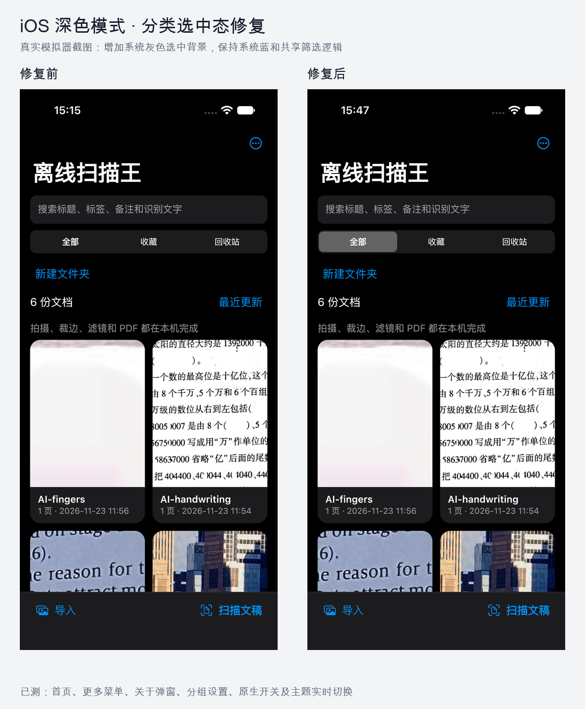

# iOS 深色模式实测

2026-11-23，iOS 27.0 arm64 模拟器。

发现并修复一处问题：文稿分类的选中背景与底色几乎相同，难以区分当前选择。修正只涉及 [iOS 分段控件](file:///Users/bytedance/workspace/kingOfScan/composeApp/src/iosMain/kotlin/com/kingscan/app/ui/IosComponents.kt#L339-L355) 的外观；深色选中态使用系统灰色，浅色仍使用白色。共享筛选和导航逻辑保持原实现。

实际截图中的选中背景由 `RGB(28,28,30)` 变为 `RGB(99,99,102)`，底色为 `RGB(28,28,31)`。Xcode 正式应用构建、安装通过；新截图已确认选中块可见。

| 检查项 | 结果 | 证据 |
| --- | --- | --- |
| 应用前台实时切入深色模式 | 通过 | [深色首页](home-after.png) |
| 首页文字、搜索提示、文稿卡片、SF Symbols | 已检查，未见其他异常 | [深色首页](home-after.png) |
| 更多菜单 | 显示、打开正常 | [菜单](menu.png) |
| 关于弹窗 | 文字、背景、按钮正常，可关闭 | [弹窗](about.png) |
| 分组设置、原生开关尺寸 | 显示正常，没有右侧裁切 | [设置](settings.png) |
| 原生开关切换 | 开启、关闭正常，未保存草稿 | [开启状态](switch-on.png) |
| 分类选中背景 | 已修复并复查 | [截图像素记录](segment-pixels.json) |
| 恢复原来的浅色模式 | 通过 | [恢复后首页](light-restored.png) |
| 本地设置与文稿元数据 | 6 份 JSON 前后哈希一致 | [检查记录](checks.json) |

桌面操作工具在继续拖动设置页时返回 `Computer Use was stopped by the user`。因此，原生滑杆实际拖动、编辑工具栏和画布、输入焦点及键盘的深色交互未完成实测，不能据此判定这些部分没有问题。此次未进行模型推理、导出、分享、删除或设备锁认证。
